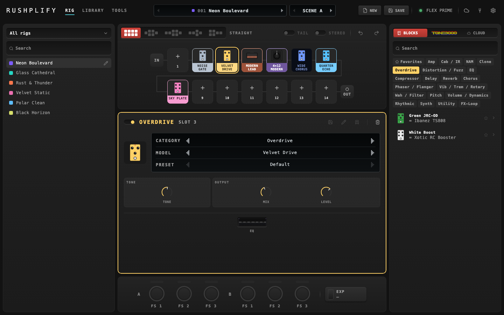
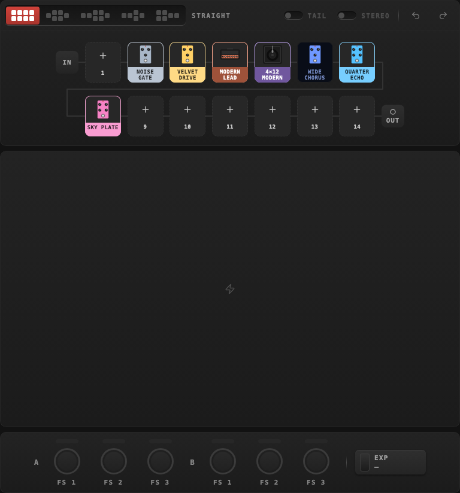
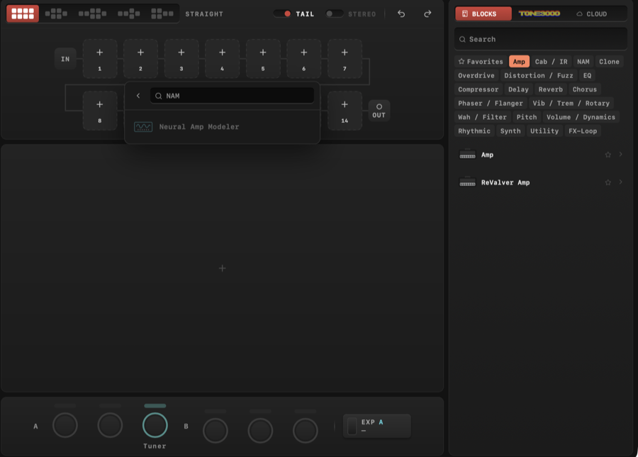
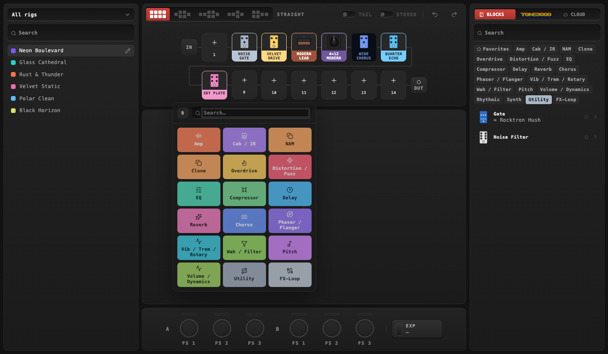
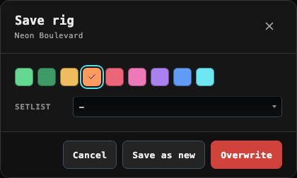
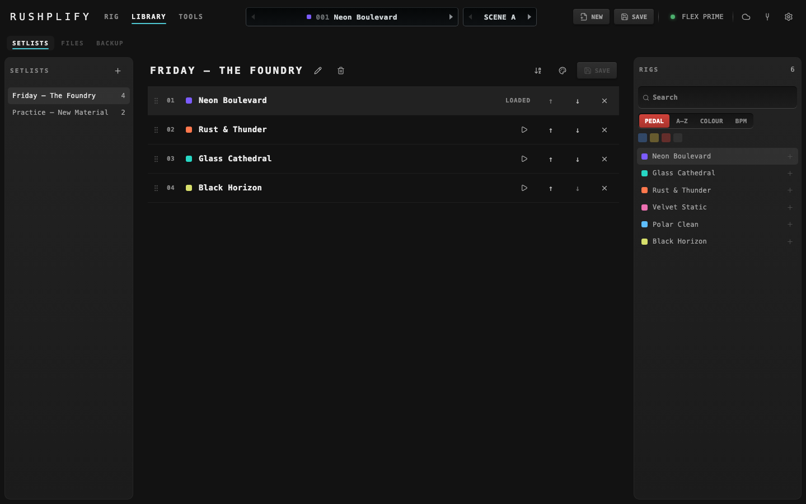
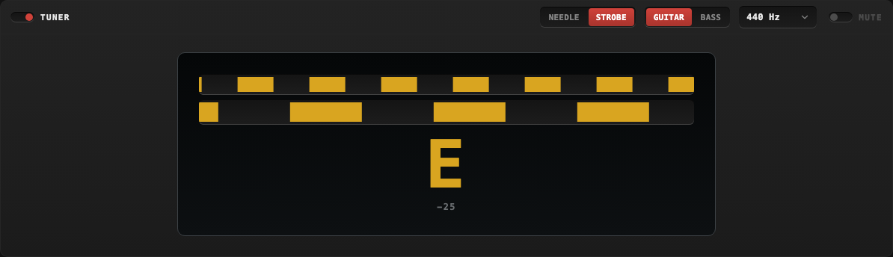
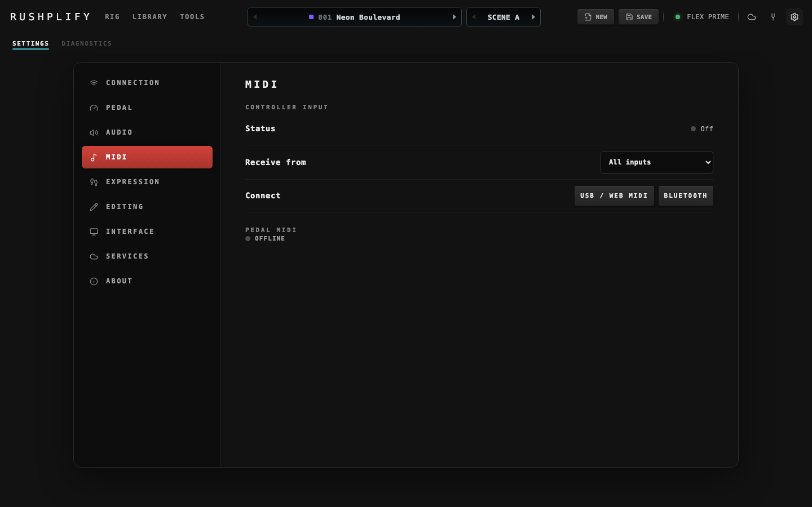

# RUSHplify

**Rigs, simplified.** A desktop editor for HeadRush Flex Prime, Prime and Core, with TONE3000 previewing built in.

HeadRush already ships a Remote Editor that runs in the browser. I wanted something quicker to work
with, so I built RUSHplify: the same rigs, scenes and setlists in a calmer layout, plus TONE3000 right
next to the chain. Pick a NAM capture, hear it through the pedal, keep it or move on.

**Early beta.** Tested with a Flex Prime on firmware 5.2.0. Make a backup on the pedal before you start.

## Download

Current version: **0.1.0-beta.2**. All versions are on the [Releases](https://github.com/Roccccky/rushplify/releases) page.

| System | Download |
| --- | --- |
| macOS, Apple Silicon (M1 and newer) | [.dmg](https://github.com/Roccccky/rushplify/releases/download/v0.1.0-beta.2/RUSHplify_0.1.0_darwin_aarch64.dmg) |
| macOS, Intel | [.dmg](https://github.com/Roccccky/rushplify/releases/download/v0.1.0-beta.2/RUSHplify_0.1.0_darwin_x64.dmg) |
| Windows 10/11 | [Installer (.exe)](https://github.com/Roccccky/rushplify/releases/download/v0.1.0-beta.2/RUSHplify_0.1.0_windows_x64_setup.exe) or [.msi](https://github.com/Roccccky/rushplify/releases/download/v0.1.0-beta.2/RUSHplify_0.1.0_windows_x64.msi) |
| Linux | [.AppImage](https://github.com/Roccccky/rushplify/releases/download/v0.1.0-beta.2/RUSHplify_0.1.0_linux_amd64.AppImage), [.deb](https://github.com/Roccccky/rushplify/releases/download/v0.1.0-beta.2/RUSHplify_0.1.0_linux_amd64.deb) or [.rpm](https://github.com/Roccccky/rushplify/releases/download/v0.1.0-beta.2/RUSHplify_0.1.0_linux_x86_64.rpm) |

The beta builds are not signed yet:

- **macOS**: right-click the app → **Open** → **Open** the first time. If macOS says the app is damaged,
  run `xattr -dr com.apple.quarantine /Applications/RUSHplify.app` once.
- **Windows**: SmartScreen shows "Windows protected your PC". Click **More info** → **Run anyway**.
- Checksums: [SHA256SUMS.txt](https://github.com/Roccccky/rushplify/releases/download/v0.1.0-beta.2/SHA256SUMS.txt).

## What it does

**RIG** – the signal chain as on the pedal: 14 slots, all routings, scenes A–F, footswitches in bank A
and B, expression. Click a block for its card, drag it anywhere in the chain, drop it on the trash to
remove it. The block browser on the right lists every model with what it was designed after.

**TONES** – hear it before you keep it. Browse, search and filter TONE3000 captures, preview one
through the pedal on the fly, and store it on the pedal when it's the one. Favourites and variants
included. The **CLOUD** tab does the same for HeadRush Cloud.

**Blocks and presets** – every block one click away. Step through categories, models and presets the
way you would on the pedal, always the shortest way.

**Saving** – save over the rig or as a new one, pick the rig colour and put it straight into a setlist.

**LIBRARY** – browse the factory rigs and your own, sort setlists by A–Z, colour or BPM, and manage
the NAM and IR files on the pedal and your restore points.

**TOOLS** – tuner with needle and strobe view, drums and global EQ.

**SYSTEM** – connection, MIDI, expression and interface settings, plus diagnostics.

## Requirements

- HeadRush Flex Prime, Prime or Core with Wi-Fi and the Remote Editor turned on (firmware 4.0 or later;
  tested on Flex Prime 5.2.0)
- Computer and pedal on the same Wi-Fi network (found as `headrushflexprime.local`,
  `headrushprime.local` or `headrushcore.local`, or by IP address)
- A TONE3000 account for the TONES tab

Without a pedal, choose **Connect to your device** to try everything in a demo session.

## Rough edges

- The builds are not signed yet (see above).
- Auditioning TONE3000 captures goes over Wi-Fi, so the first preview of a capture can take a moment.
- Only the Flex Prime is tested. Prime and Core run the same Remote Editor and should work, but I can't
  check them yet. Reports welcome.

## Feedback

This is a beta and a side project. Bug reports and ideas are welcome as an
[issue](https://github.com/Roccccky/rushplify/issues/new/choose). Please include your OS, the RUSHplify
version and the pedal firmware.

## Credits

- **NAMplify**: idea and look come from [NAMplify](https://github.com/Roccccky/NAMplify).
- **TONE3000**: RUSHplify works with TONE3000. Tones, captures, pictures, names and the TONE3000 logo
  come from TONE3000 and belong to TONE3000. The tone browser follows the
  [TONE3000 plugin](https://github.com/tone-3000/tone3000-plugin) (MIT).
- **RushLink**: parts of the code base come from [RushLink](https://github.com/Rush-Link/RushLink-App)
  by Cygma Audio (MIT).
- **HeadRush**: everything from HeadRush belongs to HeadRush / inMusic: Flex Prime, firmware, rigs,
  block and model names, labels and terms.
- Gear names after "≈" in the block lists belong to their makers and only name the sound a model
  was designed after.

RUSHplify is unofficial and not affiliated with or endorsed by HeadRush, inMusic or TONE3000.
License texts: [THIRD_PARTY_NOTICES.md](THIRD_PARTY_NOTICES.md).

## License

Open source under the MIT license, see [LICENSE](LICENSE).
